# Sanjeev Kumar S

[;AI%2FML+Systems+Builder+%7C+Distributed+%26+High-Concurrency+Systems;3rd-Year+CSE+%40+SKCET+(CGPA+8.4%2F10)+%7C+4x+National+Hackathon+Lead)](https://git.io/typing-svg)

  
  
  
  

---

### ⚡ Core Tech Stack

  

 

| Backend & Systems | Cloud & DevOps | Databases & Caching | Applied AI/ML | Frontend |
| :--- | :--- | :--- | :--- | :--- |
| • **Java 21 · Spring Boot 3** • Python (FastAPI, Django) • C / C++ (eBPF / XDP) • Node.js · REST · RBAC | • **AWS (Lambda, CDK)** • DynamoDB · Step Functions • Docker · Linux `tc-cake` • GitHub Actions CI/CD | • **PostgreSQL · MySQL 8** • Amazon DynamoDB • Redis (Bloom Filters) • Neo4j Graph DB · SQLite | • **PyTorch · Scikit-learn** • XGBoost · LangGraph • Multi-Agent Systems • Computer Vision (YOLOv8) | • **React 19** • Next.js 16 (App Router) • TypeScript • Tailwind CSS |

---

### 🚀 Featured Systems & Flagship Architectures

<table width="100%">
  <tr>
    <td width="50%" valign="top">
      <h3 align="left">
        <a href="https://github.com/Sanjeev-Sivakumar/Drishyam-Mesh">🌐 Drishyam-Mesh</a>
      </h3>
      
<b>Zero-Trust Institutional Data Governance Platform (AICTE)</b>

      

        
        
        
        
        
      

      <ul>
        <li><b>&lt; 4 ms</b> in-memory Redis Bloom Filter pre-filtering</li>
        <li>Neo4j Cypher graph traversal for duplicate seat detection</li>
        <li><b>39 / 39</b> passing E2E integration test suite</li>
        <li>DPDP Act 2023 zero-knowledge privacy compliance</li>
      </ul>
      
<a href="https://github.com/Sanjeev-Sivakumar/Drishyam-Mesh"><b>View Repository →</b></a>

    </td>
    <td width="50%" valign="top">
      <h3 align="left">
        <a href="https://github.com/Sanjeev-Sivakumar/Aegis-Volt">⚡ Aegis-Volt</a>
      </h3>
      
<b>Adaptive QoS Engine & Pre-Emptive Network Orchestrator</b>

      

        
        
        
        
      

      <ul>
        <li><b>96.8% latency reduction</b> (466.8 ms → 15.0 ms under load)</li>
        <li>Kernel-space eBPF/XDP zero-copy packet interception</li>
        <li><b>0.0% packet loss</b> on real-time interactive traffic</li>
        <li><b>&lt; 85 ms</b> atomic RCU qdisc pointer swaps via Netlink</li>
      </ul>
      
<a href="https://github.com/Sanjeev-Sivakumar/Aegis-Volt"><b>View Repository →</b></a>

    </td>
  </tr>
  <tr>
    <td width="50%" valign="top">
      <h3 align="left">
        <a href="https://github.com/Sanjeev-Sivakumar/Serverless-ML-Inference-Platform">☁️ Serverless ML Platform</a>
      </h3>
      
<b>High-Throughput Serverless Inference Architecture (AWS)</b>

      

        
        
        
        
      

      <ul>
        <li>Dynamic quantization routing (FP32 / INT8 / INT4)</li>
        <li><b>&lt; 12 ms</b> DynamoDB SHA-256 fingerprint cache hits</li>
        <li><b>40.0% cold-start drop</b> (980 ms → 588 ms)</li>
        <li><b>~60% cloud hosting cost reduction</b> under sub-200ms SLA</li>
      </ul>
      
<a href="https://github.com/Sanjeev-Sivakumar/Serverless-ML-Inference-Platform"><b>View Repository →</b></a>

    </td>
    <td width="50%" valign="top">
      <h3 align="left">
        <a href="https://github.com/Sanjeev-Sivakumar/AetherVault">🛡️ AetherVault</a>
      </h3>
      
<b>Regulatory Security Deposit & FDR Management (AICTE)</b>

      

        
        
        
        
      

      <ul>
        <li>Automated 3-way reconciliation (Claims vs OCR vs CBS/SFMS)</li>
        <li><b>Self-healing SHA-256</b> Merkle hash chain audit ledger</li>
        <li><b>AES-256-GCM</b> authenticated envelope encryption</li>
        <li>1-click court-ready legal invocation bundle generator</li>
      </ul>
      
<a href="https://github.com/Sanjeev-Sivakumar/AetherVault"><b>View Repository →</b></a>

    </td>
  </tr>
</table>

---

### 📂 Standout Engineering Repositories (Selected from 25+ Projects)

<table width="100%">
  <thead>
    <tr>
      <th align="left" width="28%">Project & Repository</th>
      <th align="left" width="22%">Engineering Domain</th>
      <th align="left" width="35%">Architecture & Technical Highlights</th>
      <th align="left" width="15%">Core Stack</th>
    </tr>
  </thead>
  <tbody>
    <tr>
      <td><b><a href="https://github.com/Sanjeev-Sivakumar/WARDEN_Algorythm">🛡️ WARDEN</a></b></td>
      <td><code>AI Agent Security</code></td>
      <td>11-pillar runtime security layer intercepting AI tool calls; PyTorch autoencoders for behavioral drift detection</td>
      <td><code>PyTorch</code> <code>TrOCR</code> <code>Python</code></td>
    </tr>
    <tr>
      <td><b><a href="https://github.com/Sanjeev-Sivakumar/Agentic-Cinema">🎬 Agentic-Cinema</a></b></td>
      <td><code>Multimodal AI Agents</code></td>
      <td>8-agent pre-clearance pipeline combining screenplay NLP, Gemini Vision, and YOLOv8 for rights clearance</td>
      <td><code>Google ADK</code> <code>YOLOv8</code> <code>FastAPI</code></td>
    </tr>
    <tr>
      <td><b><a href="https://github.com/Sanjeev-Sivakumar/Elder-Safety-Mesh">👴 Elder-Safety-Mesh</a></b></td>
      <td><code>Embedded & IoT Mesh</code></td>
      <td>Autonomous touchless spatial safety and biometric triage system for community senior care</td>
      <td><code>C</code> <code>IoT Mesh</code> <code>Sensors</code></td>
    </tr>
    <tr>
      <td><b><a href="https://github.com/Sanjeev-Sivakumar/Ring-Compass">🧭 Ring-Compass</a></b></td>
      <td><code>Spatial Algorithms</code></td>
      <td>Kinematic spatial tracking and predictive behavioral anomaly triage engine for dementia sundowning</td>
      <td><code>C</code> <code>Spatial Kinematics</code></td>
    </tr>
    <tr>
      <td><b><a href="https://github.com/Sanjeev-Sivakumar/AEGIS-Razorpay-Buildathon">💳 AEGIS-Razorpay</a></b></td>
      <td><code>FinTech Gateway</code></td>
      <td>High-throughput transaction routing and fraud verification architecture built for Razorpay Buildathon</td>
      <td><code>TypeScript</code> <code>Node.js</code></td>
    </tr>
    <tr>
      <td><b><a href="https://github.com/Sanjeev-Sivakumar/AnatomoZK">🔐 AnatomoZK</a></b></td>
      <td><code>Zero-Knowledge Cryptography</code></td>
      <td>Privacy-preserving zero-knowledge proof verification protocol for sensitive anatomical credentials</td>
      <td><code>Python</code> <code>ZK Proofs</code></td>
    </tr>
    <tr>
      <td><b><a href="https://github.com/Sanjeev-Sivakumar/AI-Cyber-Immune-System-with-Edge-Rover-for-Real-Time-Threat-Detection">🤖 AI Cyber Immune Rover</a></b></td>
      <td><code>Edge AI & Robotics</code></td>
      <td>Autonomous real-time cybersecurity threat detection pipeline running on an edge robotics rover</td>
      <td><code>Python</code> <code>Edge AI</code></td>
    </tr>
    <tr>
      <td><b><a href="https://github.com/Sanjeev-Sivakumar/phytonet-ledger">🌱 phytonet-ledger</a></b></td>
      <td><code>IoT & Web3 Protocol</code></td>
      <td>Decentralized environmental telemetry verification and microclimate sensor data logging</td>
      <td><code>TypeScript</code> <code>IoT</code> <code>Web3</code></td>
    </tr>
    <tr>
      <td><b><a href="https://github.com/Sanjeev-Sivakumar/Globetrotter-Odoo_Hackathon">🌍 Globetrotter</a></b></td>
      <td><code>Full-Stack Cloud</code></td>
      <td>Dynamic travel exploration and interactive leaderboard engine built for Odoo Hackathon</td>
      <td><code>JavaScript</code> <code>Python</code></td>
    </tr>
    <tr>
      <td><b><a href="https://github.com/Sanjeev-Sivakumar/SmartHospital-WebApp">🏥 SmartHospital WebApp</a></b></td>
      <td><code>Healthcare Systems</code></td>
      <td>Role-isolated clinical operations, ward allocation, and real-time patient triage portal</td>
      <td><code>JavaScript</code> <code>HTML5</code> <code>CSS3</code></td>
    </tr>
  </tbody>
</table>

  

---

### 🏆 Hackathon Victories & Certifications

| Award / Recognition | Event & Institution | Team Leadership |
| :--- | :--- | :---: |
| 🥇 **1st Prize Winner** | **Tech Savishkaar 3.0 National Hackathon** (Vasavi College of Engg, Hyderabad) | **Team Lead** (₹16,000 Prize) |
| 🥈 **Runner-Up** | **Proto'thon 26 National Hackathon** (Prince Dr. K. Vasudevan CET, Chennai) | **Team Lead** (₹20,000 Prize) |
| 🌟 **Special Prize** | **Theervu'athon 2025** (PSG College of Arts & Science, Coimbatore) | **Team Lead** |
| 🎬 **Finalist** | **Google Agentic Cinema Hackathon** (8-Agent Pre-Clearance Pipeline) | **Team Lead** |
| 💼 **Finalist** | **Odoo × GCET Hackathon** (Full-Stack Architecture) | **Team Lead** |
| 🏅 **Semi-Finalist** | **Smart India Hackathon (SIH)** & **graVITas'25 Top 10** (VIT Vellore) | **Team Lead** |

 

`Microsoft Certified Technology Associate (MST)` • `NPTEL IIT Certifications (DSA & Cloud)`

---

### 📊 Activity & Engineering Graphs

<table width="100%">
  <tr>
    <td width="50%" align="center" valign="middle">
      
    </td>
    <td width="50%" align="center" valign="middle">
      
    </td>
  </tr>
  <tr>
    <td width="50%" align="center" valign="middle">
      
    </td>
    <td width="50%" align="center" valign="middle">
      
    </td>
  </tr>
</table>

  

  <picture>
    <source media="(prefers-color-scheme: dark)" srcset="https://raw.githubusercontent.com/Sanjeev-Sivakumar/Sanjeev-Sivakumar/output/github-contribution-grid-snake-dark.svg">
    <source media="(prefers-color-scheme: light)" srcset="https://raw.githubusercontent.com/Sanjeev-Sivakumar/Sanjeev-Sivakumar/output/github-contribution-grid-snake.svg">
    
  </picture>

---

  Designed with precision by <b>Sanjeev Kumar S</b> • Let's build impactful, high-performance systems.

